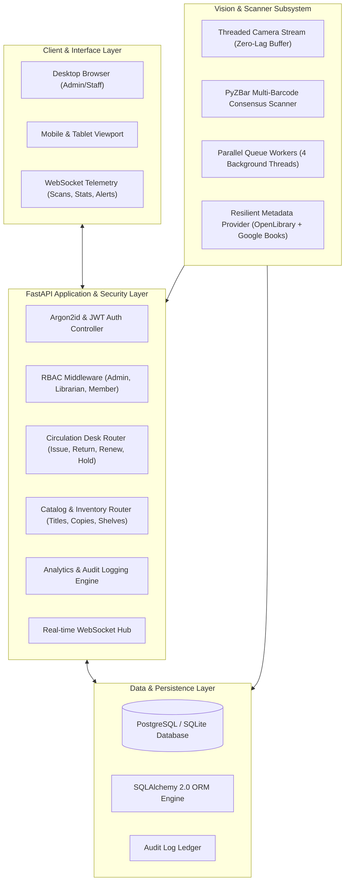

# Library Automation — Enterprise Institutional Library Management Platform (v3.0)


[](https://www.python.org/)
[](https://fastapi.tiangolo.com/)
[](https://www.sqlalchemy.org/)
[](https://opencv.org/)
[](https://www.docker.com/)
[](https://opensource.org/licenses/MIT)

An enterprise-grade, secure, multi-threaded Library Management & Automated Inventory Platform designed for university, institutional, and research libraries.

The platform pairs **real-time computer vision barcode scanning** (OpenCV + PyZBar over USB / ADB mobile cameras) with a **normalized relational database architecture** (SQLAlchemy 2.0, PostgreSQL / SQLite), **institutional circulation workflows** (issue, return, overdue fines, hold queues), **Argon2id & JWT role-based access control**, and a **reactive SaaS dashboard** with live WebSocket telemetry.

---

## 🌟 Key Platform Capabilities

- **Zero-Lag Computer Vision Scanner:** Captures ISBN barcodes via mobile cameras (ADB USB / IP Webcam) or USB webcams in a dedicated OS thread (`CAP_PROP_BUFFERSIZE=1`), with real-time AR corner reticles and cropped barcode image snapshots.
- **Normalized Relational Data Architecture:** Strictly separates **Book Titles** (bibliographic records) from **Physical Book Copies** (barcoded individual inventory units, condition grades, and shelf locations).
- **Institutional Circulation Suite:**
  - **Issue Management:** Real-time eligibility validation, borrower quota enforcement, and automated due-date scheduling.
  - **Return Management:** Checkin processing, automated overdue fine calculation ($1.00/day), and priority reservation queue fulfillment.
  - **Renewals & Hold Reservations:** Self-service and staff loan extensions with anti-hoarding and reservation blocking rules.
- **Enterprise Security & RBAC:**
  - **Argon2id Password Encryption:** State-of-the-art memory-hard hashing resistant to GPU cracking.
  - **Stateless JWT Sessions:** Bearer token headers and secure HTTP-only cookies.
  - **Granular Roles:** Super Administrator, Library Administrator, Librarian, and Student/Faculty Member.
  - **XSS Sanitization & Parameterized Queries:** Full DOM entity escaping and SQLAlchemy ORM injection prevention.
- **Dual Metadata Provider Engine:** High-speed, rate-limit-resistant book resolution through OpenLibrary (with cover art) and Google Books API fallback with offline tolerance.
- **Live Real-Time WebSockets:** Instant broadcast of barcode captures, catalog updates, inventory transitions, and audio chime sounds without page refreshes.
- **Audit Trail & Financial Ledger:** Immutable tracking of every authentication, catalog, copy, and circulation event with IP address logging.
- **Docker & PostgreSQL Ready:** Production-grade containerization with health checks and automated schema initialization.

---

## 🏗️ System Architecture



---

## 🚀 Quick Start (Local Development)

### 1. Prerequisites
- Python 3.10+ (tested on Python 3.11, 3.12, 3.14)
- Git

### 2. Clone Repository & Setup Virtual Environment
```bash
git clone https://github.com/salmanmallah/Library-Automation.git
cd Library-Automation

# Create and activate virtual environment
python -m venv .env
.\.env\Scripts\activate      # Windows
# source .env/bin/activate   # Linux/macOS

# Install dependencies
pip install -r requirements.txt
```

### 3. Initialize & Start the Platform
```bash
python main.py
```
*Your browser will automatically open at `http://localhost:8000`.*

---

## 🔐 Default Seeded Accounts

The database initializes with standard university roles out of the box:

| Role | Username | Default Password | Permissions |
| :--- | :--- | :--- | :--- |
| **Super Administrator** | `admin` | `Admin@1234` | Full system control, user provisioning, audit inspection |
| **Librarian** | `librarian` | `Lib@1234` | Cataloging, circulation desk (issue, return, renewals) |
| **Student / Member** | `student1` | `Student@1234` | Catalog search, active loans review, hold reservations |

---

## 🐳 Docker Deployment (Production)

Deploy the complete platform with PostgreSQL in two commands:

```bash
# 1. Configure environment variables (optional, defaults provided)
cp .env.example .env

# 2. Build and launch multi-container stack
docker-compose up --build -d
```

Check service status and container health:
```bash
docker-compose ps
```

Access the dashboard at `http://localhost:8000`.

---

## 📱 Mobile Camera Streaming via ADB / USB

To use your Android smartphone as an ultra-low latency hardware scanner:

1. Install **IP Webcam** (by Pavel Khlebovich) on your Android device.
2. Enable **USB Debugging** in Android Developer Options and connect your phone to PC via USB cable.
3. Open IP Webcam and tap **"Start server"** (default port 8080).
4. Launch the application (ADB port forwarding `tcp:8080 -> tcp:8080` is established automatically):
   ```bash
   python main.py --camera http://127.0.0.1:8080/video
   ```

---

## 🧪 Automated Testing & Verification

The platform includes an extensive test suite covering unit calculations, ORM transactions, authentication security, and API endpoints:

```bash
pytest -v
```

**Test Coverage Summary:**
- `test_api_endpoints.py`: Integration testing for health checks, auth login, catalog queries, issue/return endpoints, and CSV exports.
- `test_auth.py`: Argon2id password hashing, verification, JWT token generation, tampering detection, and expiry.
- `test_catalog.py`: Book deduplication, multi-copy provisioning, and deletion protection for checked-out titles.
- `test_circulation.py`: Issue validation, borrowing quota enforcement, return checkins, overdue fine formulas, and renewals.
- `test_isbn_utils.py`: Modulo 10 and Modulo 11 check digit verification for ISBN-10 and ISBN-13 (Bookland 978/979).
- `test_book_service.py`: OpenLibrary and Google Books metadata parsing resilience.
- `test_storage.py`: Dual-mode persistence and thread-safe file operations.

---

## 💻 CLI Options Reference

| Option | Type | Default | Description |
| :--- | :---: | :---: | :--- |
| `--camera` | `str/int` | `http://127.0.0.1:8080/video` | Camera URL or device index (`0`, `1`). |
| `--port` | `int` | `8000` | Web server port. |
| `--host` | `str` | `127.0.0.1` | Bind IP host (use `0.0.0.0` for public LAN access). |
| `--no-browser` | `flag` | `False` | Disable automatic web browser launch. |
| `--cooldown` | `float` | `3.0` | Cooldown in seconds before re-scanning the same barcode. |
| `--debug` | `flag` | `False` | Enable verbose debug logging. |

---

## 📄 License & Credits

Developed with precision by **Salman Mallah**.
Released under the [MIT License](LICENSE).
