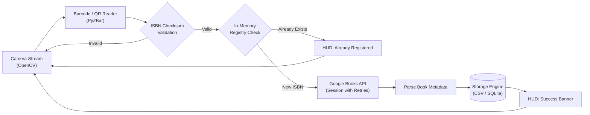

# Library Automation: Real-Time Book Cataloging System

[](https://www.python.org/)
[](https://opencv.org/)
[](https://opensource.org/licenses/MIT)

A production-grade, automated library inventory and book entry system. Using real-time computer vision (OpenCV & PyZBar), the system scans ISBN barcodes and QR codes from a camera stream, validates check digits, queries Google Books API with automated retries and rate limiting, and securely records catalog entries in CSV or SQLite formats.

---

## 🌟 Key Features

- **Real-Time Heads-Up Display (HUD):** Dynamic OpenCV bounding polygon tracking around barcodes with color-coded live status banners (Success, Already Registered, Error).
- **ISBN-10 & ISBN-13 Checksum Validation:** Verifies check digits locally before firing network requests, filtering out corrupt or invalid barcodes.
- **Smart Debouncing / Cooldown:** Prevents camera spamming and avoids hitting Google API rate limits (HTTP 429).
- **Resilient Network Layer:** Google Books API integration powered by `requests.Session` with automatic backoff retries on network failures.
- **Dual Persistent Storage:** Supports both clean, atomic CSV exports and SQLite database storage with $O(1)$ in-memory duplicate detection.
- **Graceful Shutdown:** Handles `SIGINT` (`Ctrl+C`) and `ESC`/`Q` hotkeys with clean hardware release.

---

## 🏗️ System Architecture



---

## 📋 Prerequisites & System Dependencies

`pyzbar` relies on the underlying C-library **ZBar**. Ensure it is available on your platform:

### Windows:
Usually bundled with the `pyzbar` wheel. If you encounter `Unable to find zbar shared library`, install the [Visual C++ Redistributable](https://learn.microsoft.com/en-us/cpp/windows/latest-supported-vc-redist).

### Linux (Ubuntu / Debian):
```bash
sudo apt update
sudo apt install libzbar0
```

### macOS:
```bash
brew install zbar
```

---

## 🚀 Installation

1. **Clone the repository:**
   ```bash
   git clone https://github.com/salmanmallah/Library-Automation.git
   cd Library-Automation
   ```

2. **Create and activate a virtual environment:**
   ```bash
   # Windows
   python -m venv venv
   .\venv\Scripts\activate

   # Linux / macOS
   python3 -m venv venv
   source venv/bin/activate
   ```

3. **Install dependencies:**
   ```bash
   pip install -r requirements.txt
   ```

---

## 💻 Usage & CLI Options

Run the scanner with default settings (Camera index 0, CSV output):
```bash
python main.py
```

### Advanced Command-Line Flags

| Argument | Type | Default | Description |
| :--- | :---: | :---: | :--- |
| `--camera` | `int` | `0` | Camera device index. |
| `--output` | `str` | `library_catalog.csv` | Destination CSV catalog file. |
| `--use-sqlite` | `flag` | `False` | Use SQLite database instead of CSV. |
| `--db-path` | `str` | `library_catalog.db` | Destination SQLite database file. |
| `--cooldown` | `float` | `3.0` | Seconds to wait before re-querying the same ISBN. |
| `--timeout` | `int` | `5` | HTTP request timeout in seconds. |
| `--debug` | `flag` | `False` | Enable verbose debug logging. |

### Examples:
```bash
# Use SQLite database backend
python main.py --use-sqlite --db-path my_library.db

# Use external USB camera (index 1) with debug output
python main.py --camera 1 --debug

# Custom CSV path with a 5-second cooldown
python main.py --output books_2026.csv --cooldown 5.0
```

---

## 🧪 Running Unit Tests

Run the built-in test suite to verify checksums, storage engines, and API parsing:
```bash
python -m unittest discover -s tests
```

---

## 📂 Project Structure

```text
Library-Automation/
├── core/
│   ├── __init__.py
│   ├── config.py         # Application settings & logging setup
│   ├── isbn_utils.py     # Checksum verification (ISBN-10 & 13) & data sanitization
│   ├── book_service.py   # Resilient Google Books API client with retries
│   ├── storage.py        # Thread-safe CSV & SQLite storage with O(1) deduplication
│   ├── visualizer.py     # OpenCV HUD overlay & polygon bounding boxes
│   └── scanner.py        # Video loop & real-time barcode processing
├── tests/
│   ├── __init__.py
│   ├── test_isbn_utils.py
│   ├── test_storage.py
│   └── test_book_service.py
├── main.py               # Application entrypoint & CLI argument parser
├── requirements.txt      # Project dependencies
├── .gitignore            # Git ignore rules
└── README.md             # Documentation
```

---

## 📄 License
This project is open-source and licensed under the MIT License.
