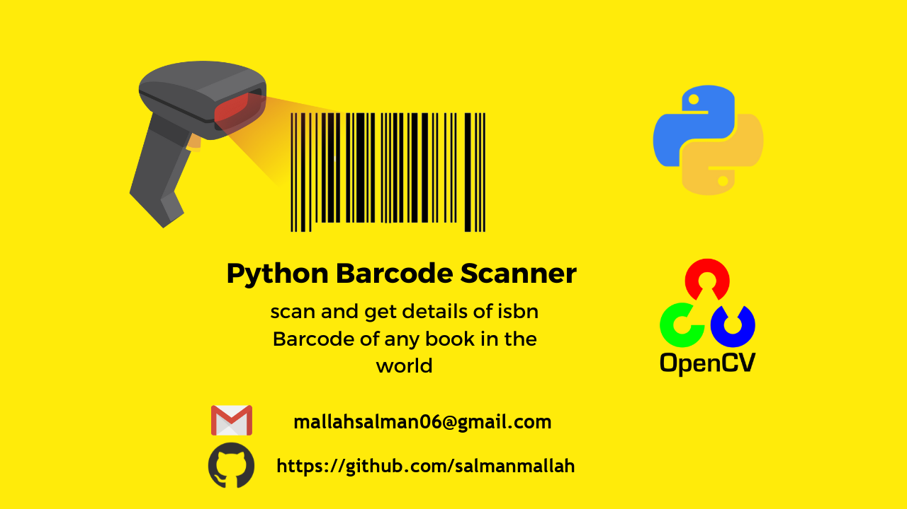
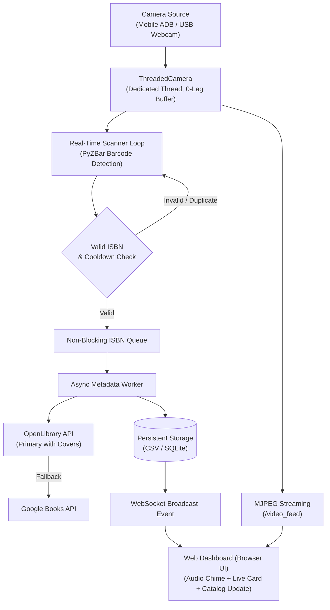

# Library Automation: Real-Time Book Cataloging System (v2.0 Web)



[](https://www.python.org/)
[](https://fastapi.tiangolo.com/)
[](https://opencv.org/)
[](https://opensource.org/licenses/MIT)

A production-grade, zero-latency automated library inventory and book cataloging system with a real-time reactive Web Dashboard. 

Using multi-threaded computer vision (OpenCV & PyZBar), the system captures ISBN barcodes directly from mobile cameras (via ADB USB / IP Webcam) or USB webcams, validates check digits, fetches rich book metadata and cover images via OpenLibrary & Google Books in a non-blocking queue, and records catalog entries in CSV or SQLite formats.

---

## 🌟 Key Features

- **Reactive Web Dashboard (FastAPI + WebSockets):** Real-time web browser UI featuring live camera stream with neon target reticles, instant scan feed, statistics, and interactive database catalog.
- **Zero-Lag Threaded Camera Engine:** Runs frame capture in a dedicated OS thread with buffer suppression (`CAP_PROP_BUFFERSIZE=1`), eliminating stream backlog and delay.
- **Asynchronous Non-Blocking Processing:** Barcode detection and network metadata lookups run on detached background worker queues, preventing camera frame drops.
- **Dual API Integration (OpenLibrary + Google Books):** Fast, rate-limit-resistant book lookups with book cover images, author, publisher, and year.
- **Mobile Camera / ADB USB Support:** Seamlessly connect phone cameras over USB with zero lag using `adb forward tcp:8080 tcp:8080` and IP Webcam.
- **Web Audio Chime / Beep:** Plays a realistic scanner beep chime in the browser upon successful book scan.
- **Manual Barcode Input:** Fallback input for damaged or scuffed barcodes.
- **CSV & SQLite Storage:** Thread-safe data persistence with $O(1)$ duplicate filtering and one-click CSV export from UI.

---

## 🏗️ System Architecture



---

## 🚀 Quick Start

1. **Clone repository and enter directory:**
   ```bash
   git clone https://github.com/salmanmallah/Library-Automation.git
   cd Library-Automation
   ```

2. **Activate your virtual environment and install dependencies:**
   ```bash
   .\.env\Scripts\activate
   pip install -r requirements.txt
   ```

3. **Start the Web Dashboard:**
   ```bash
   python main.py
   ```
   *Your browser will automatically open at `http://localhost:8000`.*

---

## 📱 Using Mobile Camera via ADB / USB

1. Install **IP Webcam** (by Pavel Khlebovich) on your Android mobile.
2. Connect mobile to PC via USB with **USB Debugging** enabled.
3. Open IP Webcam on your phone and tap **"Start server"**.
4. Run `main.py` (ADB port forwarding is handled automatically):
   ```bash
   python main.py --camera http://127.0.0.1:8080/video
   ```

---

## 💻 CLI Options

| Argument | Type | Default | Description |
| :--- | :---: | :---: | :--- |
| `--camera` | `str/int` | `http://127.0.0.1:8080/video` | Camera stream URL or device index (0, 1). |
| `--port` | `int` | `8000` | Web server port. |
| `--host` | `str` | `0.0.0.0` | Bind IP host. |
| `--no-browser` | `flag` | `False` | Do not open browser automatically on launch. |
| `--output` | `str` | `library_catalog.csv` | Output CSV catalog path. |
| `--use-sqlite` | `flag` | `False` | Store records in SQLite instead of CSV. |
| `--db-path` | `str` | `library_catalog.db` | Destination SQLite database file. |
| `--cooldown` | `float` | `3.0` | Cooldown in seconds before re-scanning the same ISBN. |
| `--debug` | `flag` | `False` | Enable debug logging. |

---

## 🧪 Running Unit Tests

```bash
python -m unittest discover tests
```

---

## 📄 License
This project is open-source and licensed under the MIT License.
